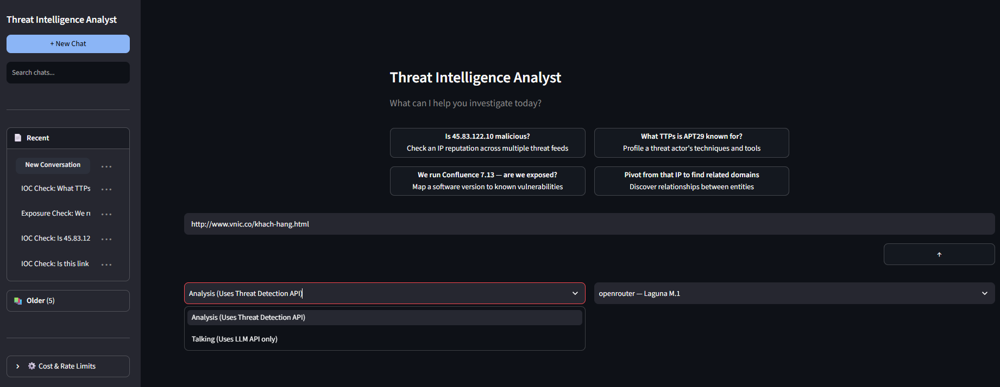

# Threat Intelligence Analyst

An agentic AI application for SOC (Security Operations Center) analysts to query threat intelligence data in natural language. Built with Google Gemini (Flash 2.0, 2.0 Lite, 2.5, 3.0), OpenRouter, VirusTotal, AbuseIPDB, AlienVault OTX, and NVD.

## Quick Start

### Step 1: Get API Keys
Sign up for free API keys at each service (all optional — missing keys simply disable that tool):

| Service | URL | Free Tier |
|---------|-----|-----------|
| VirusTotal | https://www.virustotal.com | 500 requests/day |
| AbuseIPDB | https://www.abuseipdb.com | 1,000 requests/day |
| AlienVault OTX | https://otx.alienvault.com | ~500 requests/day |
| NVD | https://nvd.nist.gov | 5 requests/30 seconds |
| Google Gemini | https://aistudio.google.com | Free tier available |
| OpenRouter | https://openrouter.ai | Free models available |

### Step 2: Set Up Your API Keys
```
pip install -r requirements.txt
```

Open `.env.example` in Notepad (or any text editor) and paste your own API keys:

```
# LLM Provider
GEMINI_API_KEY=
OPENROUTER_API_KEY=

# Threat Intelligence APIs (all optional — missing keys disable the tool gracefully)
VIRUSTOTAL_API_KEY=
ABUSEIPDB_API_KEY=
OTX_API_KEY=
NVD_API_KEY=
```

Type or paste each key after the `=` sign (no spaces, no quotes). Then save the file as `.env` (File → Save As → name it `.env`).

### Step 3: Start Investigating
```
streamlit run src/app.py
```
Your browser opens automatically at `http://localhost:8501`. Type questions like:
- *"Is 45.83.122.10 malicious?"*
- *"What TTPs is APT29 known for?"*
- *"We run Confluence 7.13 — are we exposed?"*
- *"Scan hash d41d8cd98f00b204e9800998ecf8427e"*
- *"Pivot from that IP to related domains"*

No code to write, no terminal commands to memorize beyond these three steps.

## Features

### SOC Analyst

- **Multi-Source IP Reputation** — Check IP addresses across VirusTotal, AbuseIPDB, and AlienVault OTX simultaneously for detection stats, abuse confidence scores, pulse associations, and service/port metadata
- **Domain and URL Reputation** — Analyze domains and URLs with VirusTotal and OTX for malware detections and threat pulse context
- **File Hash Analysis** — Scan MD5, SHA1, or SHA256 hashes against VirusTotal and OTX with automatic hash type detection
- **Threat Actor Profiling** — Search AlienVault OTX pulses by actor name (APT29, Lazarus, etc.) with associated TTPs, tags, and descriptions
- **Software Exposure Checks** — Map software versions to CVEs via NVD with CVSS v2/v3/v3.1 scoring, severity ratings, and CWE classifications
- **Passive DNS Pivoting** — Resolve IP addresses to related domains via VirusTotal passive DNS for investigative expansion
- **Multi-Turn Conversation** — Ask follow-up questions with natural pronoun resolution ("What's its ASN?", "Pivot to related domains", "Tell me about that hash")
- **Confidence-Scored Answers** — Every response includes a confidence score weighted by source reliability, data freshness, and completeness

### Chat Interface

- **Edit Messages** — Click the pencil icon on any user message to edit it; the edited query is immediately re-run
- **Retry Messages** — Click the refresh icon to re-run any user message, useful when an API temporarily fails
- **Delete Messages** — Click the trash icon on any message; a confirmation prompt appears before deletion
- **Retry & Edit Respect Current Settings** — Retry/Edit use the model and mode currently selected in the toolbar, not the original message's settings
- **Conversation Persistence** — All conversations are saved to a local SQLite database and restored on app reload
- **Multi-Model Selector** — Switch between Gemini and OpenRouter models at runtime via a dropdown in the input bar

### Security Engineer

- **Prompt Injection Defense** — 20 regex patterns covering instruction override, role impersonation, system prompt extraction, jailbreak terminology detection, and special tokens
- **Graceful Degradation** — All 7 API keys are optional; missing keys disable their corresponding tools without crashing; no LLM key triggers rule-based fallback
- **Observability & Tracing** — Structured JSON logging to file plus in-memory session log with real-time tool call tracing, timing, and status in the Streamlit UI
- **Rate Limit Management** — Per-API token-bucket rate limiting with daily and per-minute quotas, thread-safe acquisition, and configurable timeouts; usage persists across page refreshes
- **Persistent Cost Tracking** — Cumulative LLM token usage and cost are saved to the database and survive page refreshes, viewable in the Cost & Rate Limits sidebar panel

## Architecture

```
User query ──► Injection Guard ──► Context Manager ──► Intent Parser (LLM)
                                                          │
                                                          ▼
                                                      Tool Layer
                                               ┌─────┬───┼──┬─────┐
                                               ▼     ▼   ▼  ▼     ▼
                                            VT  Abuse OTX NVD   
                                               │     │   │  │     
                                               └─────┴───┴──┴─────┘
                                                          │
                                                          ▼
                                              Confidence Scorer
                                                          │
                                                          ▼
                                              Response Generator (LLM)
                                                          │
                                                          ▼
                                              Evidence-grounded answer
```

## Tech Stack

### LLM & AI
- Google Gemini (2.5 Flash, 2.0 Flash, 2.0 Flash Lite, 3.0 Flash)
- OpenRouter (multi-model gateway — GPT-OSS, Nemotron, Laguna, etc.)
- Rule-based fallback intent parsing (no LLM key required)

### Frontend
- Streamlit
- Python

### Backend
- Python 3.10+
- Pydantic data models
- REST API integrations (4 external services)

### Additional Technologies
- Token-bucket rate limiting
- Structured JSON observability
- Prompt injection detection (20 regex patterns)
- Confidence scoring algorithm (reliability x freshness x completeness)
- SQLite conversation persistence
- Windows installer (Inno Setup + embedded Python 3.11)

## Key Modules

### Orchestrator Pipeline

Every query flows through 7 sequential stages:

1. **Injection Guard** — Detect and block prompt injection attacks before processing
2. **Reference Resolution** — Resolve pronouns and references from conversation history
3. **Intent Parsing** — Classify query into one of 6 intents (IOC lookup, actor TTP, exposure check, pivot, context question, unknown)
4. **Tool Execution** — Dispatch to appropriate threat intelligence APIs with rate-limit-aware calls
5. **Confidence Scoring** — Weigh evidence across source reliability, data freshness, and completeness
6. **Response Generation** — Produce evidence-grounded natural language answers with source attribution
7. **Finalize** — Update conversation history and entity context for subsequent turns

### Threat Intelligence Tools

| Tool | Coverage | Data Returned |
|------|----------|---------------|
| **VirusTotal** | IP, domain, hash, URL reputation; passive DNS resolutions | Detection stats, engine counts, ASN, country, registrar, related domains |
| **AbuseIPDB** | IP abuse check | Abuse confidence score, report history, ISP, usage type, TOR status |
| **AlienVault OTX** | IP, domain, hash, URL; actor pulse search | Pulse associations, threat actor TTPs, tags, adversary names |
| **NVD** | CVE lookup by ID, keyword, or software/version (CPE-based) | CVSS v2/v3/v3.1 scores, severity, CWE IDs, references, descriptions |

### LLM Providers

| Provider | Models | Auth Method | Usage |
|----------|--------|-------------|-------|
| **Google Gemini** | gemini-2.5-flash, gemini-2.0-flash, gemini-2.0-flash-lite, gemini-3.0-flash | `GEMINI_API_KEY` env var | Intent parsing + response generation |
| **OpenRouter** | openai/gpt-oss-120b:free, nvidia/nemotron-3-nano-omni-30b-a3b-reasoning:free, poolside/laguna-m.1:free | `OPENROUTER_API_KEY` env var | Intent parsing + response generation |

When both providers are configured, you can switch between them at runtime via the model dropdown in the chat input bar. If no LLM key is set, the app falls back to deterministic rule-based intent parsing and template-based responses.

### Conversation Management

- Entity extraction for IPs, domains, hashes, actors, software, and CVEs
- Multi-turn context tracking across up to 20 messages of history
- Pronoun resolution for natural follow-up queries ("its ASN?", "that domain", "the hash")
- Persistent SQLite storage — conversations survive app restarts

### Rate Limiting

- Per-API token buckets configured with daily and per-minute limits
- Thread-safe token acquisition with busy-wait polling (up to 30s timeout)
- Graceful handling when API quotas are exceeded

### Observability

- Structured JSON logging to `threat_agent.log` plus in-memory session log
- Tool call tracing with start/end timestamps and duration measurement
- Real-time session trace panel in the Streamlit sidebar

## Adding AI Models

The application supports two LLM providers out of the box: Google Gemini and OpenRouter. You can add new models to either provider without touching any LLM client code.

### Adding a Gemini model

1. **Add the model name** to `GEMINI_MODELS` in `src/config.py`:
   ```python
   GEMINI_MODELS = ["gemini-2.5-flash", "gemini-2.0-flash", "gemini-2.0-flash-lite", "gemini-3.0-flash", "gemini-2.5-pro"]
   ```

2. **(Optional) Add pricing** to `MODEL_PRICING` in `src/config.py` so cost tracking works:
   ```python
   MODEL_PRICING = {
       ...
       "gemini-2.5-pro": {"input_per_1k": 0.00125, "output_per_1k": 0.00500},
   }
   ```

3. **(Optional) Add a display name** to `MODEL_DISPLAY` in `src/app.py` for a friendlier UI label:
   ```python
   MODEL_DISPLAY = {
       ...
       "gemini-2.5-pro": "Pro",
   }
   ```

The model will automatically appear in the dropdown selector. No other code changes are needed — the Google Gemini client (`src/llm_client.py`) handles any model name passed to it.

### Adding an OpenRouter model

1. **Add the model ID** to `OPENROUTER_MODELS` in `src/config.py`:
   ```python
   OPENROUTER_MODELS = [
       "openai/gpt-oss-120b:free",
       "nvidia/nemotron-3-nano-omni-30b-a3b-reasoning:free",
       "poolside/laguna-m.1:free",
       "meta-llama/llama-4-scout:free",
   ]
   ```

2. **(Optional) Add pricing** to `MODEL_PRICING` in `src/config.py`:
   ```python
   "meta-llama/llama-4-scout:free": {"input_per_1k": 0.0, "output_per_1k": 0.0},
   ```

3. **(Optional) Add a display name** to `MODEL_DISPLAY` in `src/app.py`:
   ```python
   "meta-llama/llama-4-scout:free": "Llama 4 Scout",
   ```

OpenRouter supports hundreds of models — find their IDs at https://openrouter.ai/models. The OpenRouter client (`src/llm_client.py`) uses the standard Chat Completions API, so any model available through OpenRouter will work.

### Adding a new LLM provider

If you want to add a completely new provider (e.g., Anthropic, OpenAI directly, Groq):

1. **Add an API key** constant in `src/config.py`:
   ```python
   ANTHROPIC_API_KEY = os.getenv("ANTHROPIC_API_KEY", "")
   ```

2. **Add a `_generate_<provider>` function** in `src/llm_client.py` following the `_generate_gemini` pattern — it must return an `LLMResponse`.

3. **Add a provider branch** in the `generate()` function:
   ```python
   if provider == "anthropic":
       return _generate_anthropic(model, system_prompt, user_prompt, config or {})
   ```

4. **Add the provider models** to the config and UI display maps as described above.

### Model pricing

When you add pricing info to `MODEL_PRICING`, the app tracks cumulative token usage and cost in the Cost & Rate Limits sidebar panel. Totals persist across page refreshes (saved to SQLite). If you leave pricing out, the cost will show as $0 but the model will still work.

## Purpose

The goal of this project is to create a conversational AI assistant that gives SOC analysts a natural language interface to query multiple threat intelligence sources simultaneously. By aggregating data from VirusTotal, AbuseIPDB, AlienVault OTX, and NVD into a single chat interface, analysts can perform investigations faster without switching between platforms. The system provides confidence-scored, evidence-attributed answers while defending against prompt injection and gracefully handling API failures and rate limits.

## Requirements

- Python 3.10+
- API keys for: Google Gemini or OpenRouter (at least one), VirusTotal, AbuseIPDB, AlienVault OTX, NVD (all optional)

## Installation

```bash
# Clone / navigate to project
cd threat-intel-agent

# Install dependencies
pip install -r requirements.txt

# Configure API keys
cp .env.example .env
# Edit .env with your API keys
```

## Configuration

Edit `.env` with your API keys:

```
GEMINI_API_KEY=your_gemini_api_key
VIRUSTOTAL_API_KEY=your_virustotal_api_key
ABUSEIPDB_API_KEY=your_abuseipdb_api_key
OTX_API_KEY=your_otx_api_key
NVD_API_KEY=your_nvd_api_key
```

All keys are optional — missing keys disable their corresponding tools gracefully. At least one LLM key (Gemini or OpenRouter) is recommended for full functionality.

## Usage

### Web UI (Streamlit)

```bash
streamlit run src/app.py
```

Opens a browser at `http://localhost:8501`. Type queries like:

- "Is 45.83.122.10 malicious?"
- "What TTPs is APT29 known for?"
- "We run Confluence 7.13 — are we exposed?"
- "Pivot from that IP to related domains"
- "and what's its ASN?" (after an IP query)
- "Scan hash d41d8cd98f00b204e9800998ecf8427e"
- "Check this URL: https://phishing.example.com"

You can edit, retry, or delete any message using the icon buttons that appear at the bottom-right of each message.

### Tests

```bash
pytest tests/ -v
```

## API Rate Limits

| API | Free Tier | Tool |
|-----|-----------|------|
| VirusTotal | 500 req/day, 4 req/min | IP, domain, hash, URL reputation, passive DNS |
| AbuseIPDB | 1,000 req/day | IP abuse confidence score |
| AlienVault OTX | ~500 req/day | Indicator lookup, pulses, actor TTPs |
| NVD | 5 req/30s (no key), 50 req/30s (with key) | CVE search by CPE / keyword |

## Multi-Turn Example

```
User: Is 45.83.122.10 malicious?
Agent: VirusTotal: 12/70 detections (malicious). AbuseIPDB: 95% confidence score.
        OTX: 3 associated pulses. Confidence: 86%.

User: What's its ASN?
Agent: [resolves "its" → 45.83.122.10]
        VirusTotal: ASN AS20473, ISP "The Constant Company"

User: Pivot to related domains.
Agent: VirusTotal passive DNS: 3 domains resolved — malware-c2.example.com,
        evil.example.net, proxy.example.org.

User: We run Confluence 7.13 — are we exposed?
Agent: NVD: CVE-2023-22527 (CVSS 9.8, CRITICAL) affects Confluence 7.13.
        CVE-2023-22524 (CVSS 7.5, HIGH). Confidence: 92%.
```

## Project Structure

```
threat-intel-agent/
├── src/
│   ├── app.py                  # Streamlit UI (chat interface, model selector, settings)
│   ├── orchestrator.py         # Main processing pipeline
│   ├── config.py               # Configuration + env vars + model lists
│   ├── models.py               # Pydantic data models
│   ├── intent_parser.py        # LLM + rule-based intent classification
│   ├── context_manager.py      # Multi-turn entity tracking + pronoun resolution
│   ├── injection_guard.py      # Prompt injection detection (direct + indirect)
│   ├── confidence.py           # Confidence scoring algorithm
│   ├── response_generator.py   # Evidence-grounded LLM + template responses
│   ├── rate_limiter.py         # Token-bucket rate limiting
│   ├── llm_client.py           # LLM provider clients (Gemini + OpenRouter)
│   ├── observability.py        # Structured logging + tracing
│   ├── conversation_store.py   # SQLite conversation persistence
│   └── tools/
│       ├── base.py             # Abstract tool base class with HTTP + retry logic
│       ├── virus_total.py      # VirusTotal API v3
│       ├── abuse_ipdb.py       # AbuseIPDB API v2
│       ├── alienvault_otx.py   # AlienVault OTX API v1
│       └── nvd_tool.py         # NVD API 2.0
├── tests/
│   ├── conftest.py             # Fixtures + mock data setup
│   ├── fixtures/mock_data.py   # Realistic mock API responses
│   ├── test_intent_parser.py
│   ├── test_tools.py
│   ├── test_context_manager.py
│   ├── test_injection_guard.py
│   ├── test_confidence.py
├── build/
│   ├── installer.iss           # Inno Setup installer script
│   ├── build_installer.ps1     # Build orchestration script
│   ├── setup_embedded_python.ps1 # Portable Python setup
│   └── launch_app.bat          # Desktop launcher
├── docs/
│   └── design-note.md          # Architecture design notes
├── requirements.txt
└── .env.example
```
